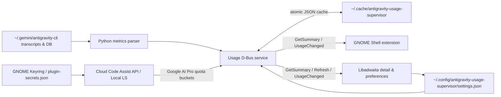

# Architecture

Antigravity Usage Supervisor separates file parsing, SQLite reads, keyring lookup,
and Cloud Code Assist quota polling from GNOME Shell's UI process.

## Components

### Metrics parser (`src/antigravity_usage_supervisor/metrics.py`)

Scans `~/.gemini/antigravity-cli/brain/*/.system_generated/logs/transcript.jsonl`,
enriched with read-only metadata from `conversation_summaries.db`,
`annotations/*.pbtxt`, `subagents/*.json`, and `cli.log`:

- Retains timestamps, conversation IDs, workspace paths, active model names,
  turn counts, and incremental per-step token counters (`input_tokens`,
  `cache_read_tokens`, `output_tokens`).
- Rolls child subagent token usage into parent conversations so top-level tasks
  reflect total task cost.
- Merges event timestamps across all concurrent conversations and subagents when
  estimating daily focus minutes.

### Account quota fetcher (`src/antigravity_usage_supervisor/account.py`)

Implements a multi-tier quota retrieval strategy for Google AI Pro individual
accounts:

1. **Cloud Code Assist API (`daily-cloudcode-pa.googleapis.com` & `cloudcode-pa.googleapis.com`):**
   - Reads OAuth credentials stored by `agy` in GNOME Keyring (`service="gemini", username="antigravity"`) or `~/.config/antigravity/plugin-secrets.json`.
   - Refreshes expired OAuth access tokens in-memory via `oauth2.googleapis.com/token`.
   - Calls `v1internal:loadCodeAssist`, `v1internal:retrieveUserQuota`, and `v1internal:retrieveUserQuotaSummary` to obtain real-time `remainingFraction` and `resetTime` for **Gemini 4 Argon** (weekly), **Gemini Models**, and **Claude & GPT Models** (each five-hour and weekly). Explicit summary windows take precedence over per-model fallbacks.
2. **Local Language Server Connect-RPC (`language_server_linux_x64`):**
   - Fallback to `POST /exa.language_server_pb.LanguageServerService/GetUserStatus` when an authenticated local IDE language server is active.
3. **Network Cache (`src/antigravity_usage_supervisor/network_cache.py`):**
   - Persists the latest valid `RateLimits` snapshot atomically in `~/.cache/antigravity-usage-supervisor/` for offline resilience.

### D-Bus service (`src/antigravity_usage_supervisor/service.py`)

Owns `io.github.owen.AntigravityUsageSupervisor` on the user session bus at
`/io/github/owen/AntigravityUsageSupervisor`:

- `GetSummary() -> JSON string`
- `Refresh() -> JSON string`
- `UsageChanged(JSON string)`

### GNOME Shell extension (`extension/extension.js`)

Renders the `G4 <percent>% left` top-panel indicator and frameless popover. Performs
only asynchronous D-Bus calls.
